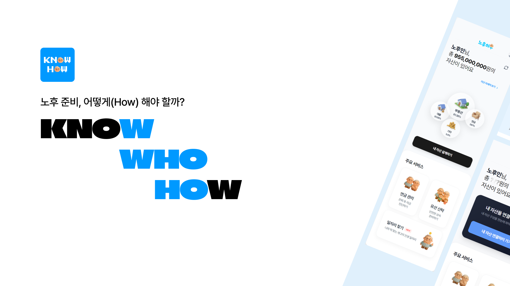
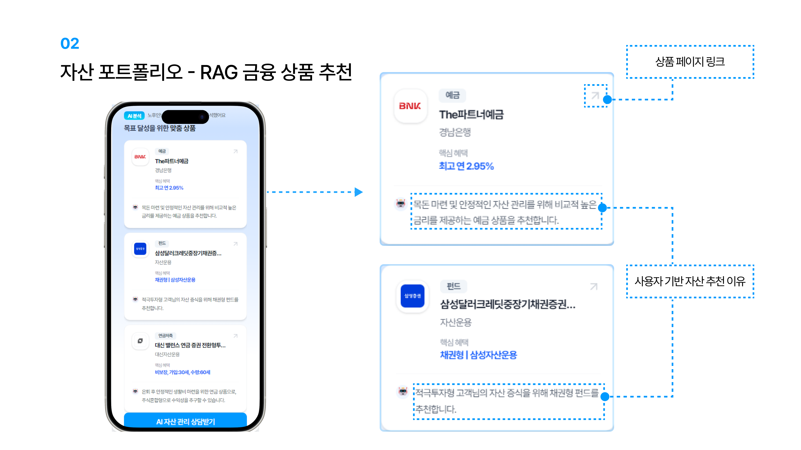
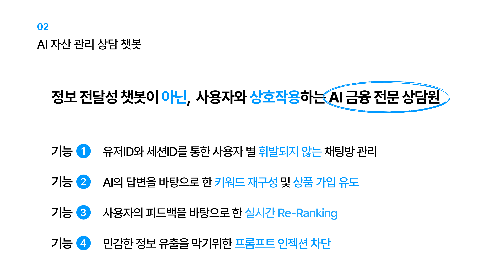
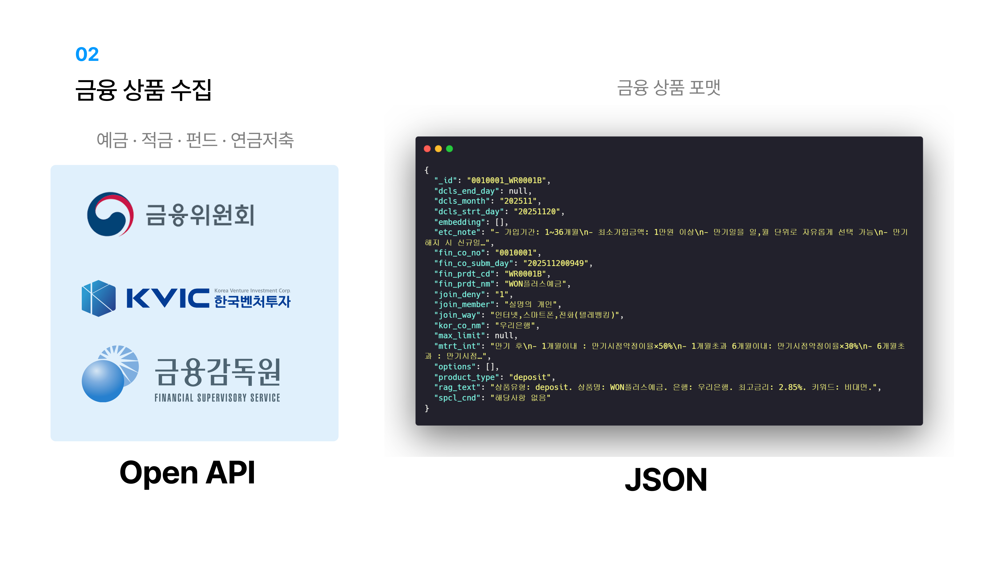
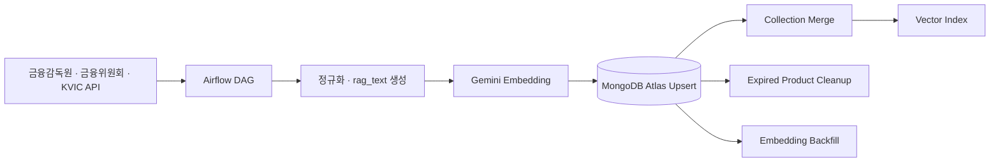
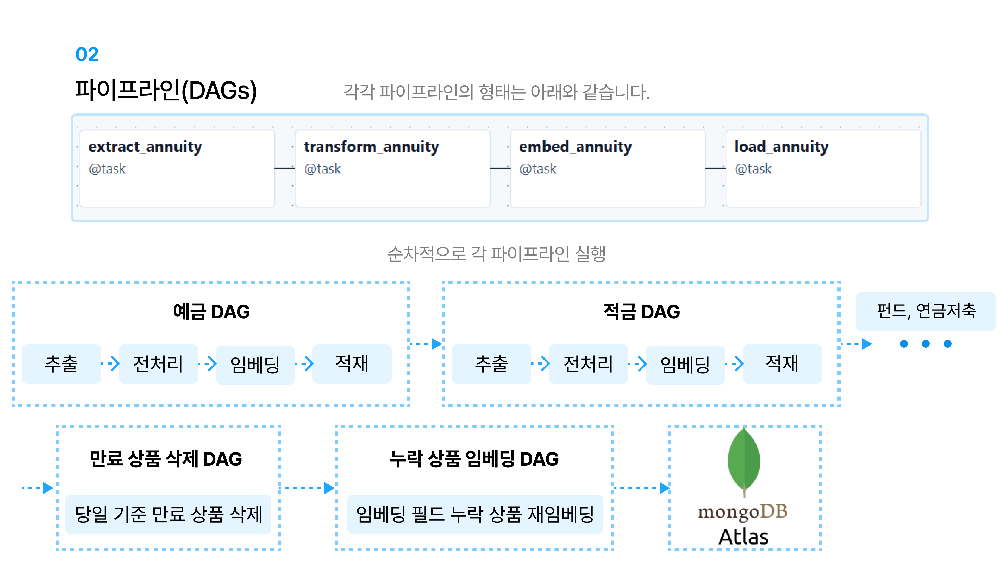
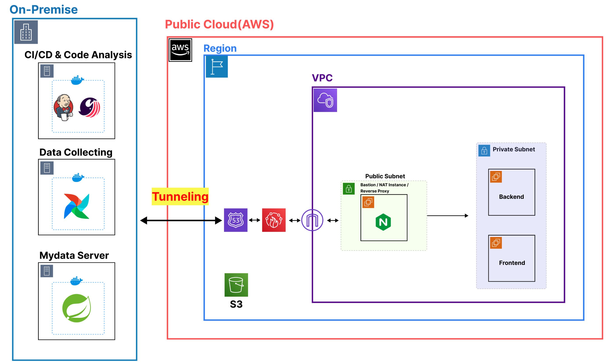
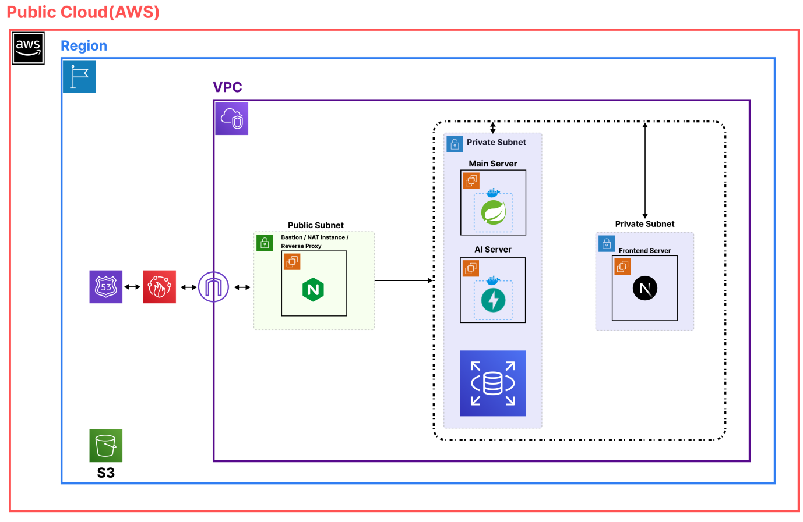
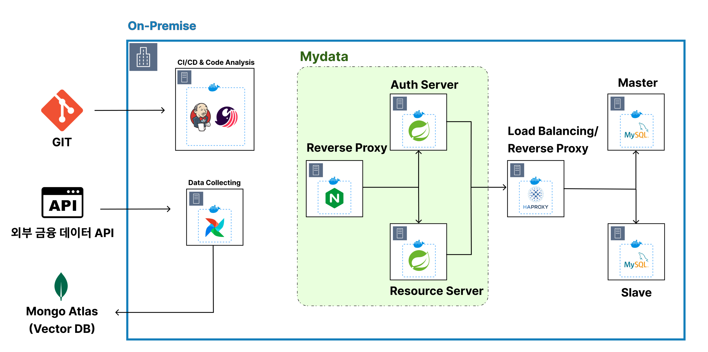

<div align="center">



# 노후하우 AI Server

> **노후 준비, 어떻게(How) 해야 할까?**
> 고객이 누구인지를 깊이 이해하고(`Know Who`), 그들에게 딱 맞는 노후 솔루션을 제시(`Know How`)하는 시니어 통합 자산 관리 & 라이프 케어 플랫폼 **노후하우(KnowWhoHow)** 의 AI 서버입니다.

<p>
  
  
  
  
  
  
</p>

</div>

## 레포지토리 소개

사용자 자산·은퇴 목표·투자 성향을 바탕으로 금융상품을 추천하는 AI 서버입니다.

## 서비스 화면

### 개인 맞춤형 금융상품 추천



사용자 자산과 목표 키워드를 기준으로 상품 후보와 추천 이유를 함께 제공합니다.

### AI 자산 관리 상담 챗봇



사용자·세션별 대화 이력을 저장하며 답변 키워드와 금융상품 추천을 연결합니다. 비선호 이력은 답변 생성 전 검증에 반영하며, 추천 결과는 검증된 상품 정보만으로 구성합니다.

## AI Pipeline

2026-11-02부터 상품 적합성은 LLM과 분리한 코드 정책으로 검증합니다.
구현 정책, 데이터 준비, 한계 및 평가 방법은 [안전한 추천](docs/safe-recommendations.md)을 참고하세요. 위험등급이 없는 원천 상품은 [상품별 공식 근거와 내부 위험분류](docs/product-evidence.md)로 보강합니다.

```text
최신 MySQL 고객 프로필 + 사용자 요청
  → LLM 요청 해석 (상품군·금융사)
  → 상품군별 후보 검색 (최대 20개)
  → 위험등급·자금·요청 조건·가입 조건·비선호 검증
  → 검증 통과 상품의 정형 응답 (최대 3개)
  → 판단 근거와 제외 사유 감사 기록
  → REST / SSE 응답
```

- 위험 1~3등급 및 고객 성향보다 위험한 상품을 제외합니다.
- 요청 상품군·금융사·금액·기간과 맞지 않거나 비선호한 상품을 제외합니다.
- 위험 및 가입 조건의 확인 근거가 없는 상품은 추천하지 않습니다. 기존 데이터에 검증 메타데이터를 보강해야 합니다.
- 적합한 후보가 없으면 추천을 보류하며 다른 금융사/상품군으로 임의 대체하지 않습니다.
- 추천 챗봇은 검증된 상품만 정형 설명하고, 일반 개념은 검토된 설명문으로 안내합니다.
- 기존 평가 결과는 아래에 역사적 기록으로 유지합니다. 부적합 추천률 18% → 2%는 측정·입증되지 않았습니다.

## Data Pipeline

사용자 자산·투자 성향·은퇴 상태 변경은 CDC로 감지해 추천용 페르소나를 자동 갱신합니다.
추천·챗봇 요청은 최신 MySQL 상태를 확인하며, 임베딩은 비동기로 처리합니다.
설계·트레이드오프·로컬 실행·검증 방법은 [사용자 상태 CDC](docs/user-state-cdc.md)에 정리했습니다.

장애 시 재시도·격리·워커 임대 복구와 운영 명령은 [CDC 장애 대응](docs/cdc-failure-runbook.md)을 참고하세요.





### Airflow DAG 구성



상품군별 DAG가 원천 데이터를 수집하고 검색용 텍스트와 임베딩을 생성. 유지보수 DAG는 만기 상품 정리, 컬렉션 통합, 누락 임베딩 보강을 맡습니다. \
만기되거나 갱신된 상품이 검색 후보에 남지 않도록 수집 DAG와 유지보수 DAG를 분리했습니다. 만기 상품 정리, 컬렉션 통합, 임베딩 backfill을 자동화해 검색 인덱스의 상태를 일정하게 유지하도록 합니다.

## System Architecture

### Hybrid Architecture



민감 정보 보호와 비용 효율성을 위해 온프레미스와 AWS를 터널링으로 연결한 하이브리드 구조입니다. CI/CD·데이터 수집·MyData는 온프레미스에서, Main·AI·Frontend 서버는 AWS Private Subnet에서 운영합니다.

### AWS Cloud Architecture



외부 요청은 Route 53과 WAF를 거쳐 Public Subnet의 Nginx Reverse Proxy로 전달된 후, Private Subnet의 대상 서버로 라우팅됩니다. 내부 서버의 직접 SSH 접근은 차단하며, 허용된 IP의 관리자만 분리된 접속 키와 SSH ProxyJump를 사용해 Bastion Host를 경유합니다.

### On-Premise Architecture



온프레미스에는 CI/CD와 MyData 시스템을 구성했습니다. Jenkins는 관리자 IP만 허용하고 민감 정보는 Credentials로 관리하며, MyData 트래픽은 Nginx와 HAProxy를 거쳐 Master·Slave DB로 분산됩니다. Airflow가 수집한 금융 데이터는 MongoDB Atlas의 벡터 검색에 활용됩니다.

## 기술 스택

| Area      | Technology                        | Role                                    |
| --------- | --------------------------------- | --------------------------------------- |
| LLM       | Gemini 2.5 Flash / Groq Qwen3-32B | 추천 근거 생성, 스트리밍 상담           |
| Agent     | LangGraph, LangChain              | 검색 도구 선택과 Agent-Tool 반복 실행   |
| Embedding | Google `text-embedding-004`       | 사용자·상품 텍스트 벡터화               |
| Retrieval | MongoDB Atlas Vector Search       | 상품군별 의미 기반 Top-K 검색           |
| AI API    | FastAPI                           | 추천·벡터화·SSE 챗봇 API                |
| Data      | Apache Airflow, Pandas, PyMongo   | 금융상품 ETL·임베딩·적재·정리           |
| Storage   | MongoDB Atlas, MySQL              | 벡터/로그 저장, 사용자 원천 데이터 조회 |

## 평가

평가 기준일: `2025-12-09`

| 평가            | 데이터와 기준                                                              |                    결과 |
| --------------- | -------------------------------------------------------------------------- | ----------------------: |
| RAG 시나리오    | 추천·지식·보안·일상대화 등 53개 질의의 의도/키워드/상품 반환 검증          |       **46/53 (86.8%)** |
| Retrieval       | 추천 및 특정 상품 검색 25개 질의에서 기대 키워드가 Top-K에 포함되는지 확인 | **Recall@1/3/5 = 0.92** |
| API 단위 테스트 | Chat·Recommendation·Vectorization·Admin, 외부 의존성 Mock                  |          **38/38 통과** |

평가 원본은 [`rag_eval_result_final_20251209.csv`](server/tests/evaluation/rag_eval_result_final_20251209.csv), 테스트 범위는 [`test_results_report.md`](server/tests/test_results_report.md)에 정리돼 있다.

## Core API

| Method | Endpoint                            | Description                        |
| ------ | ----------------------------------- | ---------------------------------- |
| `GET`  | `/api/v1/recommendations/{user_id}` | 사용자 페르소나 기반 금융상품 추천 |
| `POST` | `/api/v1/chat/stream`               | SSE 기반 AI 상담                   |
| `POST` | `/api/v1/chat/feedback`             | 상품 좋아요·싫어요 저장            |
| `GET`  | `/api/v1/chat/history`              | 세션별 대화 내역 조회              |
| `POST` | `/api/v1/users/{user_id}/vectorize` | 사용자 페르소나 생성 및 벡터 갱신  |

### Admin API

| Method | Endpoint                       | Description                                     |
| ------ | ------------------------------ | ----------------------------------------------- |
| `GET`  | `/api/v1/admin/stats/overview` | 전체 대화·API 호출·만족도·활성 사용자 통계 조회 |
| `GET`  | `/api/v1/admin/stats/trends`   | 월별 대화 및 API 요청 추이 조회                 |
| `GET`  | `/api/v1/admin/stats/feedback` | 좋아요·싫어요 피드백 분포 조회                  |
| `GET`  | `/api/v1/admin/users`          | 사용자별 AI 사용량과 만족도 조회                |
| `GET`  | `/api/v1/admin/logs`           | 사용자별 최근 챗봇 대화 로그 조회               |
| `GET`  | `/api/v1/admin/logs/{user_id}` | 특정 사용자의 전체 대화 내역 조회               |

## 구현 사항

- 금융상품 ETL 및 임베딩 파이프라인
- 사용자 마이데이터 기반 페르소나 생성과 벡터화
- LangGraph 상품 추천 에이전트와 카테고리별 검색 도구
- 구조화 추천 API, SSE 챗봇, 피드백 재정렬
- RAG 시나리오 평가와 API 단위 테스트

<details>
<summary><strong>Directory Structure</strong></summary>

```text
ai-server/
├── airflow/
│   ├── dags/                 # 상품 수집·임베딩·정리 DAG
│   └── plugins/etl_utils.py  # 공통 ETL 로직
├── server/
│   ├── app/api/              # FastAPI endpoints
│   ├── app/rag/              # LangGraph, tools, prompts
│   ├── app/services/         # 추천·채팅·벡터화 서비스
│   └── tests/                # API 및 RAG 평가
├── scripts/                  # 데이터 보정 유틸리티
└── docker-compose.local.yml
```

</details>
