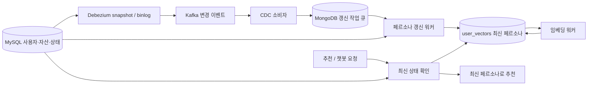

# 사용자 금융 상태의 실시간 반영

## 해결하는 문제

기존 추천·챗봇은 MongoDB에 저장된 페르소나를 재사용했다. MySQL의 자산,
투자 성향, 은퇴 상태가 바뀌어도 벡터화 API가 다시 호출되지 않으면 이전 정보가
추천 문맥으로 사용될 수 있었다.

이번 변경은 **금융 상태의 최신성**과 **임베딩 생성의 성공 여부**를 분리한다.
추천에 실제로 사용되는 것은 사용자 페르소나 텍스트다. 최신 텍스트를 먼저 게시하고
임베딩은 별도 작업으로 갱신하므로 외부 임베딩 API 장애가 상태 갱신을 막지 않는다.

## 데이터 흐름



- 감지 테이블: `users`, `user_info`, `assets`, `user_keyword`, `keyword`.
- 이벤트는 갱신할 사용자 ID를 찾는 데 사용한다. 이벤트 도착 순서대로 자산을 더하거나
  빼지 않고, MySQL의 최신 committed 상태를 한 REPEATABLE READ 트랜잭션으로 다시 읽는다.
- CDC 토픽에는 식별·연결용 컬럼만 포함한다. 비밀번호, 연락처, 자산 금액을 복제하지 않는다.
- 자산의 소유자가 변경되면 before/after의 두 사용자 모두 갱신한다.
- 키워드 삭제 시 FK cascade로 관계가 사라져도 기존 페르소나의 `keyword_ids`로 영향 사용자를 찾는다.
- 원천 사용자 삭제는 페르소나·임베딩을 제거한 tombstone으로 반영한다.
- 자산 상세의 총액·대출·순자산을 명시하며, 원천의 `asset_total`과 구분한다.
  금액을 억/만원 단위로 반올림하지 않아 작은 잔액 변경도 반영한다.

## 최신성 보장과 트레이드오프

CDC는 비동기이므로 DB commit 직후의 무지연 반영을 보장하지 않는다.
추천·챗봇의 금융 문맥을 만들 때 원천을 다시 읽어 **요청 중 읽은 일관된 스냅샷**을 사용한다.
읽기 시작 이후 발생한 변경, 응답 생성 도중 발생한 변경까지 반영하는 것은 아니다.
진행 중인 SSE 응답을 중단하거나 자동으로 재추천하는 기능은 포함하지 않는다.

이 보완 경로 덕분에 CDC 소비자가 중단되어도 신규 요청은 오래된 캐시를 사용하지 않는다.
대신 요청마다 MySQL 조회와 MongoDB 게시 비용이 발생하고, MySQL 장애 시 추천을 실패시킨다.
오래된 금융정보로 계속 응답하는 방식보다 최신성을 우선하는 선택이다.
향후 CDC 지연과 부하를 측정한 뒤 허용 지연을 정하고 캐시 중심의 읽기 정책을 도입할 수 있다.
현재 단계에서 CDC의 역할은 요청이 없어도 추천용 데이터를 지속적으로 갱신하는 것이다.

## 재전달·동시성·장애 처리

1. 소비자는 MongoDB 작업 큐의 journal/majority 쓰기 성공 후 offset을 수동 커밋한다.
   저장 후 커밋 전에 종료되면 같은 이벤트가 다시 들어와 최신 상태를 재조회한다.
2. 사용자별 작업 `generation`을 사용해 처리 중 들어온 새 이벤트를 삭제하지 않는다.
3. 페르소나 갱신은 source read 전에 revision을 예약하고 조건부 저장한다.
   늦게 끝난 이전 조회는 더 최근 조회를 덮어쓰지 못하고 재시도한다.
4. 임베딩 저장은 페르소나 hash와 삭제 상태를 확인한다.
   이전 텍스트의 임베딩이 늦게 완료되어도 최신 상태를 덮어쓰지 못한다.
5. 변경 없는 텍스트와 동일한 모델은 재임베딩하지 않는다. 변경 시 이전 벡터를 제거한다.
6. 원천/MongoDB 실패는 작업 큐에 남겨 최대 60초 backoff로 재시도한다.
   임베딩 실패는 페르소나를 유지하며 30초 후 재시도한다.
7. 잘못된 CDC 메시지는 offset을 넘기지 않고 소비자를 실패시킨다. 운영자가 로그와
   connector 상태를 확인해 수정해야 한다. 자동 DLQ 건너뛰기는 아직 제공하지 않는다.

작업 큐는 사용자별 현재 상태 갱신 용도다. 모든 중간 자산 상태를 보존하는 감사 이력이나
Kafka와 MongoDB 전체에 대한 exactly-once 구현은 아니다. 초기 구성은 refresh/embed 워커를
각각 하나씩 실행한다. 여러 워커로 확장하려면 lease·claim을 추가해야 불필요한 중복 작업을 줄일 수 있다.

## 로컬 실행

실제 사용자 DB와 분리된 MySQL fixture, MongoDB, Kafka, Debezium, 워커를 제공한다.
비밀번호와 평문 네트워크는 로컬 데모 전용이다. 운영용 접속은 별도 계정·권한·TLS 설정이 필요하다.

```powershell
Copy-Item .env.cdc.example .env.cdc
# .env.cdc에서 GEMINI_API_KEY를 설정
docker compose -f docker-compose.cdc.yml up -d --build
Invoke-RestMethod http://localhost:8083/connectors/user-state-cdc/status
docker compose -f docker-compose.cdc.yml logs -f cdc-consumer persona-worker embedding-worker
```

Connector와 task가 모두 RUNNING인지 확인한다. 초기 snapshot으로 사용자 1의 페르소나가 생성된다.
설정 등록 성공만으로 snapshot 또는 CDC 정상 동작을 판단하지 않는다.

```powershell
docker compose -f docker-compose.cdc.yml exec cdc-mysql mysql -uapp -papp_demo knowhow -e "UPDATE assets SET balance=123456789.01 WHERE asset_id=1; UPDATE user_info SET retirement_status=1 WHERE user_id=1;"
docker compose -f docker-compose.cdc.yml exec cdc-mongo mongosh financial_products --quiet --eval 'db.user_vectors.findOne({user_id:1})'
```

`persona_text`의 정확한 금액·은퇴 상태가 변하고, 임베딩 생성 중에는 `embedding_status=pending`이 된다.
금액·상태는 임베딩 성공 전에도 사용할 수 있다. 데모 MongoDB는 일반 MongoDB이므로 기존 Atlas
상품 Vector Search를 그대로 지원하지 않으며 상품도 seed하지 않는다. 전체 추천 E2E 검증은 기존
Atlas 상품 컬렉션·검색 인덱스를 연결한 별도 환경에서 진행한다.

CDC 누락 복구를 위한 전체 재조정:

```powershell
docker compose -f docker-compose.cdc.yml run --rm persona-worker python -m app.pipelines.worker reconcile
```

이 명령은 원천 사용자와 기존 projection 사용자를 큐에 넣는다. 삭제 누락도 다시 확인한다.
정기 배치가 필요하면 해당 명령을 운영 스케줄러에 등록한다. 기존 상품 Airflow DAG는 유지한다.

기존 DB에 연결할 때는 MySQL binlog `ROW`/`FULL`, 보존 기간, CDC 계정 권한을 먼저 확인한다.
`cdc/mysql-init.sql`은 로컬 fixture 전용이며 운영 DB에 실행하지 않는다. `.env.cdc`의 원천 주소,
DB명·토픽 접두어를 동일하게 맞추고 connector를 등록한다. API 서버도 동일 원천과 MongoDB를 사용해야 한다.

## 검증과 측정

```powershell
python -m pip install -r tests/pipeline/requirements.txt
python -m pytest tests/pipeline -q
```

자동 테스트는 중복·삭제·자산 소유자 변경·상태 변경·임베딩 실패·동시 갱신·늦은 임베딩 완료·큐 재전달을 검증한다.
MongoDB 동작은 mongomock으로 검증하므로 실제 binlog, Kafka 재시작, MongoDB journal 장애 검증을 대체하지 않는다.

이번 리팩토링 검증 결과:

- 파이프라인·구성 테스트 28개, CDC 소비자·최신 문맥 서비스 테스트 8개,
  기존 추천·챗봇·벡터화 API 테스트 27개: 합계 **63개 통과**.
- 기존 관리자 API 테스트 15개는 `/api/admin`을 호출하지만 실제 라우트가 `/api/v1/admin`이어서 404로 실패한다.
  이 리팩토링에서는 관리자 경로를 변경하지 않았다.
- 기존 SSE 테스트의 AsyncMock 사용에서 미대기 coroutine 경고 3개가 발생한다.
  최신 문맥은 별도의 서비스 테스트로 검증했다.
- Python 구문 검사와 Docker Compose 구성 검사 통과.
- 작업 환경의 Docker 엔진이 실행되지 않아 실제 컨테이너 CDC·추천 E2E는 검증하지 못했다.

운영 실험에서는 DB commit → `source_checked_at`, `embedding_updated_at`까지의 p50/p95 지연,
consumer lag, 작업 큐 건수·최고 대기시간, 재시도 횟수, 임베딩 호출 수를 측정한다.
Connector/task 실패는 REST status로 확인한다. 소비자와 워커 로그에 ID·offset·오류 유형만 기록한다.
실측하지 않은 지연 개선 수치나 운영 안정성은 자소서에 기재하지 않는다.

설계 참고: [Debezium MySQL](https://debezium.io/documentation/reference/3.3/connectors/mysql.html),
[Kafka 외부 시스템 처리 의미론](https://kafka.apache.org/design/),
[Kafka Docker](https://kafka.apache.org/41/getting-started/docker/).
